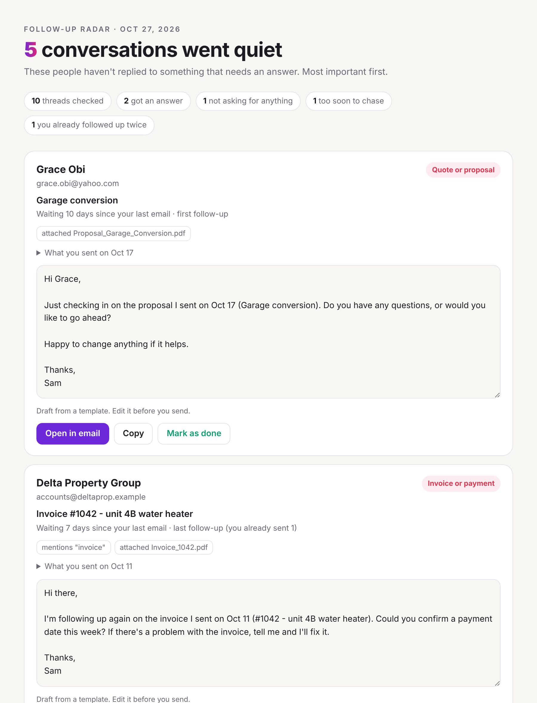

# Follow-up Radar

**Find the emails that never got a reply, and get a follow-up draft for each one.**

[](https://github.com/beraiautomation/follow-up-radar/actions/workflows/ci.yml)


[](LICENSE)

<picture>
  <source media="(prefers-color-scheme: dark)" srcset="docs/report-dark.png">
  
</picture>

<sub>The report from the built-in demo: a made-up repair business with 17 emails.</sub>

You send a quote. The customer goes quiet. You get busy, and the job goes to someone who
called back faster. On small business forums, "follow-up is harder than getting leads" is one
of the most common complaints.

Follow-up Radar reads your sent mail, finds every quote, invoice, meeting request or question
that got **no reply**, and writes a short, polite follow-up for each one. You check it and send it
yourself.

- **Read-only.** It never sends, moves, deletes or marks anything as read.
- **Runs on your computer.** Your email doesn't go anywhere. There's no account and no server.
- **Smart about what counts.** It skips thank-you notes, newsletters, threads where they already
  answered (even from a colleague at the same company), and people you've already followed up with twice.
- **Drafts you can trust.** Templates by default. If you use an AI model, every draft is checked,
  and one that adds a price, date or amount that wasn't in your email is thrown out.

## No terminal? Use the Gmail version

Paste one file into [script.google.com](https://script.google.com), click **Run**, and that's it.
Every morning, your follow-ups are waiting in **Gmail Drafts**, inside the original conversations,
plus a Google Sheet with the list. It never emails your customers: you check each draft and press Send.

**[Set up the Gmail version in 5 minutes →](gmail/SETUP.md)**

## Try it in 10 seconds (Python version)

You need Python 3.9 or newer. There's nothing to install.

```bash
git clone https://github.com/beraiautomation/follow-up-radar
cd follow-up-radar
python3 -m radar demo
```

On Windows, type `py` instead of `python3`. The report opens in your browser.

## Run it on your own email

### Gmail, iCloud, Yahoo, Fastmail and most others (IMAP)

```bash
python3 -m radar imap --email you@gmail.com
```

It asks for an **app password**. That's a separate password made just for this kind of tool, so
you never type your real password. It isn't saved anywhere.

| Provider | Where to get an app password |
|---|---|
| Gmail | Turn on 2-Step Verification, then go to [myaccount.google.com/apppasswords](https://myaccount.google.com/apppasswords) |
| iCloud | [account.apple.com](https://account.apple.com) > Sign-In and Security > App-Specific Passwords |
| Yahoo | Account Info > Account Security > Generate app password |

You can delete the app password as soon as you're done.

### A Gmail export (no password at all)

Download your mail from [Google Takeout](https://takeout.google.com) (choose Mail, `.mbox` format), then:

```bash
python3 -m radar mbox "~/Downloads/All mail Including Spam and Trash.mbox" --me you@gmail.com
```

### A folder of .eml files

```bash
python3 -m radar eml ~/Desktop/emails --me you@company.com
```

**Outlook and Hotmail:** not supported over IMAP yet, because Microsoft requires a different
sign-in method. It's next on the list.

## Options

| Option | What it does | Default |
|---|---|---|
| `--days 30` | How far back to look | 30 |
| `--wait 3` | Days without a reply before a thread shows up | 3 |
| `--max-followups 2` | Stop suggesting after this many follow-ups | 2 |
| `--ignore-domain mycompany.com` | Skip a domain, like your own team (repeatable) | none |
| `--name "Sam"` | Name for the sign-off | taken from your sent mail |
| `--out ~/follow-ups` | Where the report goes | `~/follow-up-radar` |

You get `follow-ups.html` (the report), `follow-ups.csv` (for a spreadsheet) and `follow-ups.json`.

## Better drafts with AI (optional)

With [Ollama](https://ollama.com) on your computer, drafts are written by a local model and nothing
leaves your machine:

```bash
ollama pull llama3.2
python3 -m radar imap --email you@gmail.com --model llama3.2
```

Any OpenAI-compatible service works too. Set `--model-url` and put the key in the
`FOLLOWUP_RADAR_API_KEY` environment variable. Then the text of the emails you're following up on
is sent to that service.

**Every AI draft is checked before you see it.** If it adds a number that wasn't in your email (a
new price, a discount, a date), uses a placeholder like `[Name]`, or runs too long, it's thrown out
and you get the template instead. The report says when that happened.

## How it decides

1. Your sent emails are grouped into threads by subject and contact.
2. A thread is **answered** if the contact replied, or someone from the same company did, after
   your last email. Free email domains like gmail.com don't count as "the same company."
3. Your email has to **ask for something**: a quote, proposal or estimate, an invoice, a meeting,
   or a question. A proposal file attached is enough. A plain "thanks!" isn't.
4. It shows up after `--wait` days, and stops after `--max-followups` follow-ups so you don't nag.
5. Quotes and invoices come first, then meetings, then questions. Older ones come first within each group.

All of this is rules you can read in [`radar/analyze.py`](radar/analyze.py). No AI decides what to
show you.

## Use it as a skill

`skills/follow-up-radar/SKILL.md` teaches a coding agent like Claude Code to run the radar and
help you go through the list. Copy it into your skills folder:

```bash
cp -r skills/follow-up-radar ~/.claude/skills/
```

Then ask: *"Run follow-up-radar on my Gmail and help me with the follow-ups."*

## Two versions, same rules

| | Gmail version | Python version |
|---|---|---|
| Setup | Paste into script.google.com | `python3 -m radar` |
| Email | Gmail and Google Workspace | Gmail, iCloud, Yahoo, Fastmail, exports |
| Runs | Every morning, by itself | When you run it |
| Drafts | In Gmail Drafts, in the thread | Report page with "Open in email" |
| AI drafts | Not yet | Optional, checked for made-up numbers |

Both use the same rules for what counts as a quiet conversation, and both are tested in CI.

## Limits

- Threads are matched by headers and subject, not by AI. A reply sent by phone, or from a new
  email address, can be missed. The tool will then suggest a follow-up you don't need, so read
  each one before sending.
- English keywords only for now.
- "Open in email" starts a new message with "Re:" in the subject. It doesn't attach to the
  original thread in every email app. Copy and reply in the thread if you prefer.

## License

MIT. Made by Berzaf Teklu. Built to solve one boring problem well.
